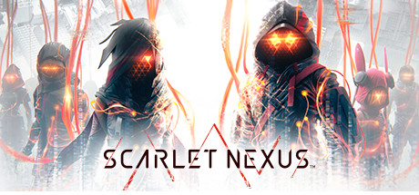

**Scarlet Nexus by Bandai Namco (2021) is an anime action RPG set in a world where humanity fights brain-hungry Others.**

---

## 📖 About

Scarlet Nexus by Bandai Namco (2021) is an anime action RPG set in a world where humanity fights brain-hungry Others. The Bond System lets you borrow abilities from party members, creating deep combo potential. New Game Plus dual-protagonist stories reveal the full picture of a well-crafted narrative.

## ⚠️ Problems Without Trainer

| Problem | Status |
|---------|--------|
| Brain Field meter depletes rapidly preventing extended use during boss fights | ✅ Solved |
| SAS ability cycling requires memorizing six party member skills under pressure | ✅ Solved |
| Bond level grinding for unlocking party member abilities is repetitive | ✅ Solved |
| Hard mode enemy immunity windows extend to punish players without ideal SAS | ✅ Solved |
| Crush and stagger mechanics require timing-precise attack sequencing | ✅ Solved |

## ✅ Solution

The **Scarlet Nexus Trainer** solves all these issues, giving you complete control so you can focus on enjoying the game.

## 🎯 Features

- Unlimited Resources / Currency
- God Mode / Invincibility
- Instant Skill & Ability Cooldown
- One-Hit Kill
- Freeze Timers
- Unlock All Items & Achievements
- Custom Speed Multiplier
- Infinite Stamina / Energy

## 🚀 Quick Start

1. **Disable Windows Defender** temporarily (trainer may trigger false positive)
2. Get the trainer from the button above
3. Launch Scarlet Nexus
4. Run the trainer as Administrator
5. Use the hotkeys to activate cheats in-game

## 💎 Free vs Pro

| Feature | Free | Pro |
|---------|------|-----|
| God Mode | ✅ | ✅ |
| Unlimited Resources | ✅ | ✅ |
| Advanced Cheats | ❌ | ✅ |
| Auto-Updates | ❌ | ✅ |
| Priority Support | ❌ | ✅ |

## 💻 Requirements

- Windows 10 / 11 (64-bit)
- Scarlet Nexus (any version)
- .NET Framework 4.8+
- DirectX 11+

## 🍎 macOS

## ⚖️ Legal

Educational and single-player use only.

---

